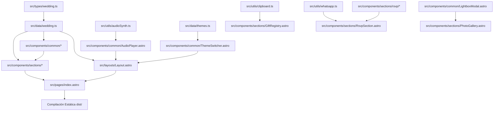

# 🏛️ Arquitectura del Software y Separación de Responsabilidades

Este proyecto sigue una arquitectura estricta orientada a componentes desacoplados, datos fuertemente tipados, modularidad atómica y estilos basados en tokens CSS nativos.

---

## 📐 Estructura de Directorios

```text
src/
├── data/
│   ├── themes.ts              # Paletas cromáticas dinámicas y variables CSS correspondientes
│   └── wedding.ts             # ÚNICA FUENTE DE VERDAD (Single Source of Truth) de los datos del evento
├── types/
│   └── wedding.ts             # Definiciones e interfaces TypeScript (contratos de datos)
├── utils/
│   ├── audioSynth.ts          # Síntesis acústica en tiempo real con Web Audio API (cero dependencias)
│   ├── clipboard.ts           # Copiado universal al portapapeles con microinteracciones y toast
│   └── whatsapp.ts            # Formateador semántico de mensajes Markdown y generador de URL wa.me
├── components/
│   ├── common/                # Componentes utilitarios y globales interactivos
│   │   ├── AddToCalendar.astro # Integración con Google Calendar y descarga de .ics estándar
│   │   ├── AudioPlayer.astro   # Reproductor musical flotante con ecualizador animado
│   │   ├── LightboxModal.astro # Modal accesible <dialog> para ampliación de fotografías
│   │   ├── SectionHeader.astro # Encabezados de sección con motivos geométricos y florales
│   │   └── ThemeSwitcher.astro # Panel interactivo flotante para cambio de paletas en vivo
│   ├── icons/                 # Biblioteca propia de 17 iconos 100% vectoriales en SVG
│   │   ├── OliveBranch.astro  # Motivo botánico de ramita de olivo
│   │   ├── WhatsAppIcon.astro # Icono vectorial oficial de WhatsApp
│   │   ├── HeartIcon.astro    # Corazón estilizado
│   │   └── ...                # Cero emojis en toda la aplicación
│   └── sections/              # Componentes de bloque para cada sección de la página
│       ├── Header.astro       # Navegación con menú responsive y botón directo de RSVP
│       ├── Hero.astro         # Portada con foto en arco y cuenta regresiva
│       ├── Countdown.astro    # Temporizador en JS Vanilla con tabular-nums
│       ├── StoryTimeline.astro# Línea cronológica con fotos WebP y diseño alternado
│       ├── CeremonyReception.astro # Lugares, mapas interactivos embebidos y enlaces Waze
│       ├── ScheduleTimeline.astro # Itinerario horario del gran día
│       ├── DressCode.astro    # Muestras de paleta sugerida y código de vestimenta
│       ├── PhotoGallery.astro # Galería escalonada editorial conectada al Lightbox
│       ├── Lodging.astro      # Hoteles recomendados con distancias y tarifas estimadas
│       ├── GiftRegistry.astro # Cuentas bancarias en Soles y USD, CCI y botón de copiado
│       ├── RsvpSection.astro  # Formulario interactivo principal
│       │   └── rsvp/          # Subcomponentes atómicos del formulario:
│       │       ├── AttendanceSelector.astro # Selector Sí / No con tarjetas accesibles
│       │       ├── GuestStepper.astro       # Contador numérico con botones +/-
│       │       └── MenuSelector.astro       # Tarjetas de selección de menú (tradicional, veg, etc.)
│       ├── ContingencyPlan.astro # Plan B y enlace de descarga de PDF oficial
│       ├── Faq.astro          # Preguntas frecuentes con etiquetas semánticas details/summary
│       ├── Contact.astro      # Enlaces directos por correo y WhatsApp para consultas
│       └── Footer.astro       # Monograma, hashtag, aviso legal y créditos
├── layouts/
│   └── Layout.astro           # Documento HTML5, SEO, Open Graph, fuentes y barra de scroll
├── styles/
│   ├── variables.css          # Tokens de diseño (paleta HSL/Hex, espaciados, tipografías)
│   ├── reset.css              # Reset moderno, accesible y soporte prefers-reduced-motion
│   └── global.css             # Clases utilitarias, animaciones, botones y contenedores
└── pages/
    └── index.astro            # Ensamblador de alto nivel de todas las secciones
```

---

## 🔄 Flujo de Datos y Dependencias



---

## 💡 Decisiones de Diseño Técnico

### 1. Astro 7 sin Sobrecarga de Frameworks en Tiempo de Ejecución
- No se cargan React, Vue ni Svelte en el cliente.
- El bundle de JavaScript final es ultra liviano (apenas unos kilobytes en scripts modulares de TypeScript).
- Cumple con los estándares más rigurosos de Astro 7 en validación de marcado HTML5 estricto.

### 2. Síntesis Musical Acústica con Web Audio API (`src/utils/audioSynth.ts`)
- En lugar de obligar al usuario a descargar archivos de audio MP3 pesados (que consumen megabytes de datos móviles y pueden tener problemas de copyright o buffering), se implementó un sintetizador nativo ligero.
- Utiliza osciladores triangulares y curvas de ganancia exponenciales que imitan la calidez de cuerdas acústicas pulsadas y notas de celesta.
- Progresión armónica suave en tonalidad campestre (Re, Sol, Si menor, La Mayor) ejecutada en arpegios de 340ms.
- El usuario tiene control total mediante un botón flotante con indicador de vinilo giratorio y ecualizador animado.

### 3. Selector Dinámico de Paletas en Vivo (`src/components/common/ThemeSwitcher.astro`)
- Pensado tanto para la personalización de los novios como para la demostración interactiva de portafolio.
- Modifica directamente las *CSS Custom Properties* en `document.documentElement` en tiempo real sin recargar la página ni alterar el árbol del DOM.
- Los temas configurados en `src/data/themes.ts` cubren:
  - **Oliva & Oro**: Armonía clásica y campestre.
  - **Rosa Polvo**: Enfoque floral y romántico.
  - **Azul Noche**: Estilo nocturno de máxima elegancia y etiqueta formal.
  - **Terracota**: Estilo boho-chic cálido y artesanal.
- La preferencia elegida se persiste automáticamente en `localStorage` (`boda_tema_elegido`).

### 4. Visor Lightbox Modal Accesible (`src/components/common/LightboxModal.astro`)
- Implementado con el elemento nativo HTML5 `<dialog>`.
- Permite abrir cualquiera de las fotos de la galería en tamaño completo con fondo oscurecido translúcido.
- Cuenta con navegación hacia adelante y atrás, contador dinámico, soporte para teclado (`Escape`, flechas) y bloqueo de desplazamiento del fondo.

### 5. Modularidad Atómica del RSVP (`src/components/sections/rsvp/`)
- El formulario se dividió en componentes especializados con responsabilidad única:
  - `AttendanceSelector.astro`: Maneja la selección visual entre "¡Sí, asistiré!" y "No podré asistir".
  - `GuestStepper.astro`: Control accesible con botones de incremento/decremento para la cantidad de pases.
  - `MenuSelector.astro`: Selector tipo tarjeta con distintivos visuales para opciones de banquete (Tradicional, Vegetariano, Vegano, Infantil).
- Toda la serialización y construcción de la URL de WhatsApp se delega a `src/utils/whatsapp.ts`, garantizando tipado estricto con `RsvpFormData`.

### 6. Copiado Accesible al Portapapeles (`src/utils/clipboard.ts`)
- Facilita la copia inmediata de números de cuenta corriente y Códigos de Cuenta Interbancaria (CCI).
- Proporciona retroalimentación visual dual: cambia el texto del botón a "¡Copiado!" con check y activa un toast flotante temporal.
